# attacker-audit

An agent skill that audits a web app codebase the way someone trying to break into it would look at it. It runs 23 checks, gives each one PASS, FAIL, or CAN'T TELL with file and line evidence, and ranks the failures into the order you should fix them.

It is read-only. It writes a report and asks which fixes to apply. It does not change code, rotate keys, or touch production.

## Why

Apps built fast, especially with AI coding tools, tend to fail in the same handful of places: a key in the bundle, a table with row level security off, a server action anyone can call, a webhook nobody verifies, an AI route with no rate limit that someone else ends up paying for. None of these need a skilled attacker. They need someone with a browser, `curl`, and ten minutes.

This skill checks for exactly those, and it's honest about what it can't see. Plenty of security lives outside the repo (dashboard settings, edge rate limits, environment variables), so those checks come back CAN'T TELL with instructions for where to look, instead of a false PASS.

## What it checks

| Group | Checks |
|---|---|
| 1. Secrets | hardcoded keys · committed .env · keys in git history · keys in the frontend bundle |
| 2. Auth | routes with no session check · frontend-only permission checks · user IDs trusted from the request · tokens in localStorage · no email verification or password rules |
| 3. Database | tables with RLS off · policies that leak other users' rows · IDs with no ownership check · updates that save the whole request body |
| 4. Input | SQL built from strings · user content rendered as raw HTML · no server-side validation · unchecked file uploads |
| 5. Exposure | no rate limits on login or AI routes · unsigned webhooks · CORS set to * · open admin or debug routes · stack traces in production · outdated dependencies |

Full definitions, search patterns, and FAIL criteria are in [`CHECKS.md`](skills/attacker-audit/CHECKS.md).

## What you get

1. **Recon**: stack, every server entry point, where access rules live.
2. **Checklist**: all 23 rows, each with a verdict, severity, and location.
3. **Findings**: for every FAIL, the file and line, a one-line description of the attack, and the exact fix.
4. **Can't tell**: what to check outside the repo and where.
5. **Fix order**: failures ranked by how likely they are to hurt you, not just by severity. A leaked key in public git history goes before a CRITICAL that needs a signed-in user, because bots find the key first.

See [`examples/sample-report.md`](examples/sample-report.md).

## Install

Copy `skills/attacker-audit/` into your agent's skills directory:

- **Claude Code**: `~/.claude/skills/attacker-audit/` (all projects) or `.claude/skills/attacker-audit/` (one project)
- **Claude apps**: zip the `attacker-audit` folder and upload it as a skill
- **Other agents**: point the agent at `SKILL.md`; it reads `CHECKS.md` and `report-template.md` from the same folder

The skill is three markdown files with no scripts. Read them before you install it.

## Use

From the root of the repo you want to audit:

> Run an attacker audit on this codebase.

Works best with a full git clone (for the history check) and, if available, `gitleaks` and your package manager's audit command installed. It falls back to grep when they aren't.

## Stack coverage

The core checks are stack-agnostic. Stack notes add specific patterns where they matter.

| Stack | Coverage |
|---|---|
| Next.js (app and pages router) | Strong |
| Supabase | Strong |
| Stripe, Shopify, GitHub, Svix webhooks | Strong |
| Firebase | Partial |
| Express, Remix, SvelteKit, Nuxt | Partial (core checks only) |
| Django, Rails, Laravel | Partial (core checks only) |
| Mobile (React Native, Expo) | Not yet |

Want better coverage for your stack? That's the most useful contribution. See below.

## Contributing

This is meant to improve in public. The most useful contributions:

- **A check that missed something real.** Open a [false negative](https://github.com/andrewluxem/attacker-audit/issues/new?template=false-result.yml) issue with the pattern it missed.
- **A check that flagged something safe.** Same template, marked false positive.
- **Stack notes** for frameworks with partial or no coverage.
- **A new check.** Open a [new check](https://github.com/andrewluxem/attacker-audit/issues/new?template=new-check.yml) issue first so we can agree on scope and severity.

Read [`CONTRIBUTING.md`](CONTRIBUTING.md) before opening a PR.

## Limits

This is a first-pass review, not a penetration test or a guarantee. A clean report means these 23 checks found nothing in the code the agent could read. It says nothing about business logic flaws, infrastructure, or anything the checks don't cover. For apps handling payments, health data, or other people's money, get a human security review as well.

The agent running the skill can be wrong. Verify every CRITICAL before acting on it, and never paste real secrets from the report into issues or chats.

## License

MIT. See [LICENSE](LICENSE).

Part of [andrewluxem/playbooks](https://github.com/andrewluxem/playbooks). Companion to [repo-audit-prompt](https://github.com/andrewluxem/repo-audit-prompt), which audits third-party repos before you adopt them. This one audits your own.
